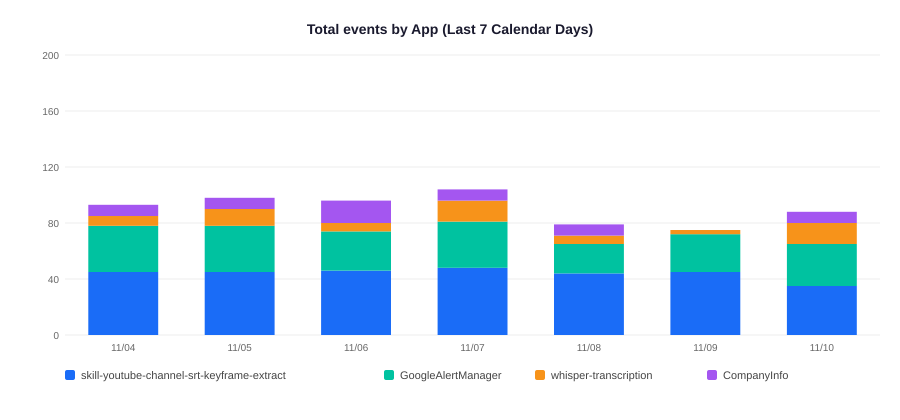
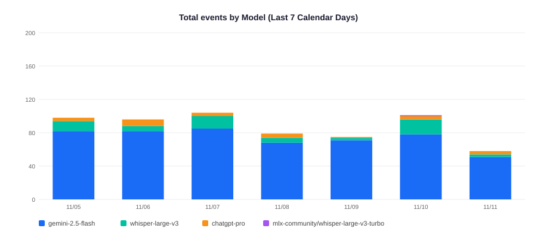
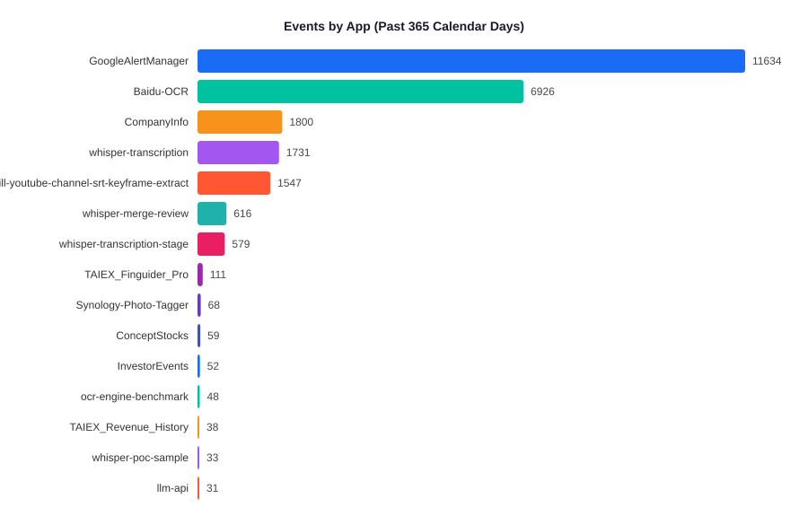
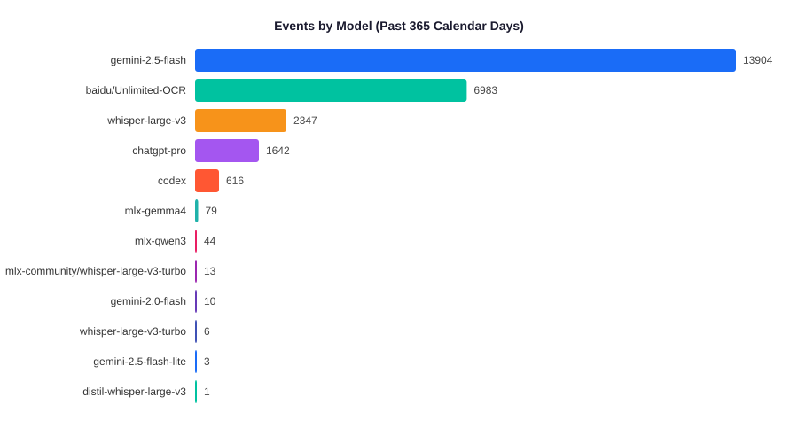

# llm

一個統一的 LLM 客戶端函式庫，封裝了 **Gemini API** (具備金鑰輪轉功能)、**LLM-CLI-API-Server** (封裝 `codex-cli` 與 `gemini-cli` 的橋接器) 以及 **MLX** (本地 Apple Silicon 推論)。

## 🌟 核心特色

- **自動備援鏈 (Fallback Chain)**：預設路徑為 `gemini` → `codex` → `mlx`。當高優先級的 CLI 橋接或 API 失敗時，自動切換至備援方案。
- **Gemini 金鑰輪轉**：支援多達 20 把 API Key (`GEMINI_API_KEY` + `_1` 到 `_19`)，具備每日配額偵測與 Round-robin 輪轉機制。
- **CLI 橋接功能 (LLM-CLI-API-Server)**：
    - **ChatGPT Pro**：透過伺服器端的 `codex-cli` 調用具備訂閱權限的 ChatGPT。
    - **遠端 Gemini**：透過伺服器端的 `gemini-cli` 調用 Gemini (適用於 IP 受限或需集中管理金鑰的場景)。
- **本地 MLX 推論**：支援連線至 `MLX-API-Server` 進行本地高效能推論。
- **數據分析**：整合 Amplitude，自動追蹤每次調用的 Provider、模型、耗時、Token 數與成功率。
- **智慧路由 (Smart Routing)**：自動評估與優化推論路徑。透過「先評審、後晉升」機制，在確保品質的前提下，自動切換至更經濟或快速的模型（如本地 MLX 或 NAS 上的 Gemini-CLI），並支援 NAS 端的「自我反思」加速。
- **結構化輸出**：所有 Provider (包含 CLI 橋接) 均支援 `JSON Mode`，確保回傳資料符合預期的 Schema。

---

## API Usage Statistics

*Powered by [Amplitude Analytics](https://amplitude.com) · Updated: 2026-11-14 07:52 CST*


*Periods use the Amplitude project timezone: past 365 calendar dates, the last 7 calendar dates, and today (a partial day). Events without `app_name` are shown as `(missing app_name)`. Duration is omitted until the API query can be reported accurately.*











### Smart Routing (Efficiency)

| Status | Past 365 Calendar Days | Last 7 Calendar Days | Today | Description |
|--------|------------------------|--------------------|-------|-------------|
| Draft Passed | 10 | 0 | 0 | Saved powerful model cost. |
| Judge Replaced | 83 | 0 | 0 | Corrected by powerful model. |
| Fallback (Error) | 2319 | 205 | 20 | Automatic fallback to Gemini. |
| NAS Reflection | 71 | 0 | 0 | App used draft_provider='codex'; draft+judge ran entirely on NAS via gemini-cli. |

#### Smart Routing by Application

| App | Past 365 Calendar Days | Last 7 Calendar Days | Today |
|-----|------------------------|--------------------|-------|
| GoogleAlertManager | 1532 | 181 | 16 |
| CompanyInfo | 906 | 24 | 4 |
| InvestorEvents | 29 | 0 | 0 |
| ConceptStocks | 16 | 0 | 0 |


### Gemini API (Direct)

| Model | Past 365 Calendar Days | Last 7 Calendar Days | Today |
|-------|------------------------|--------------------|-------|
| `gemini-2.5-flash` | 14132 | 396 | 20 |
| `gemini-2.0-flash` | 10 | 0 | 0 |
| `gemini-2.5-flash-lite` | 3 | 0 | 0 |

#### All Applications

| Application | Past 365 Calendar Days | Last 7 Calendar Days | Today |
|-------------|------------------------|--------------------|-------|
| GoogleAlertManager | 11765 | 187 | 16 |
| skill-youtube-channel-srt-keyframe-extract | 1510 | 185 | 0 |
| CompanyInfo | 762 | 24 | 4 |
| ConceptStocks | 32 | 0 | 0 |
| InvestorEvents | 29 | 0 | 0 |
| TAIEX_Finguider_Pro | 25 | 0 | 0 |
| llm-api | 8 | 0 | 0 |
| TAIEX_Revenue_History | 5 | 0 | 0 |
| TravelAPP | 3 | 0 | 0 |
| TestSmartRouting | 2 | 0 | 0 |
| TW-institutional-investment-theses | 1 | 0 | 0 |
| TW-institutional-research | 1 | 0 | 0 |
| debug-probe-app | 1 | 0 | 0 |
| diagnostic-test | 1 | 0 | 0 |


### Llm-Cli-APIServer

| Model | Past 365 Calendar Days | Last 7 Calendar Days | Today |
|-------|------------------------|--------------------|-------|
| `chatgpt-pro` | 1658 | 26 | 4 |
| `codex` | 616 | 0 | 0 |

#### All Applications

| Application | Past 365 Calendar Days | Last 7 Calendar Days | Today |
|-------------|------------------------|--------------------|-------|
| CompanyInfo | 1094 | 24 | 4 |
| whisper-merge-review | 616 | 0 | 0 |
| skill-youtube-channel-srt-keyframe-extract | 257 | 2 | 0 |
| TAIEX_Finguider_Pro | 82 | 0 | 0 |
| GoogleAlertManager | 72 | 0 | 0 |
| TAIEX_Revenue_History | 33 | 0 | 0 |
| ConceptStocks | 27 | 0 | 0 |
| InvestorEvents | 23 | 0 | 0 |
| llm-api | 23 | 0 | 0 |
| ServerSmartTest | 14 | 0 | 0 |
| TAIEX_Compare | 10 | 0 | 0 |
| TAIEX_Finguider_Gen | 7 | 0 | 0 |
| TAIEX_Visualizer | 7 | 0 | 0 |
| SmartTest | 6 | 0 | 0 |
| TAIEX_Finguider_HighQual | 1 | 0 | 0 |
| TAIEX_Google_Visualizer | 1 | 0 | 0 |
| debug-probe-app | 1 | 0 | 0 |


### Local Inference (MLX/Whisper/OCR)

| Model | Past 365 Calendar Days | Last 7 Calendar Days | Today |
|-------|------------------------|--------------------|-------|
| `baidu/Unlimited-OCR` | 6983 | 0 | 0 |
| `whisper-large-v3` | 2623 | 348 | 73 |
| `mlx-gemma4` | 79 | 0 | 0 |
| `mlx-qwen3` | 44 | 0 | 0 |
| `mlx-community/whisper-large-v3-turbo` | 14 | 2 | 1 |
| `whisper-large-v3-turbo` | 6 | 0 | 0 |
| `distil-whisper-large-v3` | 1 | 0 | 0 |

#### All Applications

| Application | Past 365 Calendar Days | Last 7 Calendar Days | Today |
|-------------|------------------------|--------------------|-------|
| Baidu-OCR | 6926 | 0 | 0 |
| whisper-transcription | 2032 | 350 | 74 |
| whisper-transcription-stage | 579 | 0 | 0 |
| Synology-Photo-Tagger | 68 | 0 | 0 |
| ocr-engine-benchmark | 48 | 0 | 0 |
| whisper-poc-sample | 33 | 0 | 0 |
| eval-gemma4 | 26 | 0 | 0 |
| test-mlx | 20 | 0 | 0 |
| SmartTest | 8 | 0 | 0 |
| test-mlx-gemma4 | 5 | 0 | 0 |
| TAIEX_Finguider_Pro | 4 | 0 | 0 |
| GoogleAlertManager | 1 | 0 | 0 |

#### Application by Model

| Application | Model / Engine | Past 365 Calendar Days | Last 7 Calendar Days | Today |
|-------------|----------------|------------------------|--------------------|-------|
| Baidu-OCR | Baidu OCR | 6926 | 0 | 0 |
| whisper-transcription | whisper-large-v3 | 2012 | 348 | 73 |
| whisper-transcription-stage | whisper-large-v3 | 578 | 0 | 0 |
| Synology-Photo-Tagger | mlx-gemma4 | 59 | 0 | 0 |
| ocr-engine-benchmark | Baidu OCR | 48 | 0 | 0 |
| whisper-poc-sample | whisper-large-v3 | 33 | 0 | 0 |
| test-mlx | mlx-qwen3 | 20 | 0 | 0 |
| whisper-transcription | mlx-community/whisper-large-v3-turbo | 14 | 2 | 1 |
| eval-gemma4 | mlx-gemma4 | 13 | 0 | 0 |
| eval-gemma4 | mlx-qwen3 | 13 | 0 | 0 |
| Synology-Photo-Tagger | Baidu OCR | 9 | 0 | 0 |
| SmartTest | mlx-qwen3 | 8 | 0 | 0 |
| whisper-transcription | whisper-large-v3-turbo | 6 | 0 | 0 |
| test-mlx-gemma4 | mlx-gemma4 | 5 | 0 | 0 |
| TAIEX_Finguider_Pro | mlx-gemma4 | 2 | 0 | 0 |
| TAIEX_Finguider_Pro | mlx-qwen3 | 2 | 0 | 0 |
| GoogleAlertManager | mlx-qwen3 | 1 | 0 | 0 |
| whisper-transcription-stage | distil-whisper-large-v3 | 1 | 0 | 0 |


## 📦 安裝方式

### 選項 A：本地路徑 (開發環境)

在 `pyproject.toml` 中加入：
```toml
[project]
dependencies = [
    "llm @ file:///${PROJECT_ROOT}/../llm",
]
```

或使用 uv：
```bash
uv add --editable "../llm"
```

### 選項 B：GitHub 倉庫 (CI/CD 或正式環境)

```toml
[project]
dependencies = [
    "llm @ git+https://github.com/wenchiehlee/llm.git",
]
```

---

## ⚙️ 環境變數設定

請複製 `.env.example` 並更名為 `.env`。**注意：API Key 中若包含 `#` 字元可能導致解析錯誤，請確保 Key 的正確性。**

### 1. Gemini (直接調用 API)
- `GEMINI_API_KEY`: 主要金鑰。
- `GEMINI_API_KEY_1` ... `19`: 額外的輪轉金鑰。
- `GEMINI_SKIP_KEYS`: 以逗號分隔，指定要手動跳過的金鑰名稱。

### 2. LLM CLI API Server (遠端 CLI 橋接)
- `CODEX_API_KEY`: 存取伺服器的驗證金鑰。
- `LLM_MAX_PROMPT_LENGTH`: 統一 client-level prompt guard；設為 `0`（預設）表示不設全域上限。
- `CODEX_MAX_PROMPT_LENGTH`: Codex provider 的本地 prompt guard；設為 `0` 可停用，但遠端 bridge 仍可能有自己的限制。
- `GEMINI_MAX_PROMPT_LENGTH`: Gemini provider 的本地 prompt guard。
- *註：伺服器需預先安裝 `codex-cli` 與 `gemini-cli`。*

### 3. MLX API Server (本地推論)
- `MLX_API_URL`: MLX 伺服器網址。
- `MLX_SERVER_API_KEY`: 驗證金鑰。

### 4. 監控與分析 (選填)
- `AMPLITUDE_API_KEY`: Amplitude 專案金鑰。
- `LLM_APP_NAME`: 應用程式名稱，用於區分流量來源。

---

## 🚀 使用範例

### 基礎調用
```python
from llm import LLMClient

# 初始化 (自動偵測可用 Provider：gemini → codex → mlx)
client = LLMClient(app_name="NewsAnalyzer")

# 普通文本生成 (預設會先嘗試透過 Gemini API)
text = client.generate("請簡述台積電在 2024 年的營收表現。")

# JSON 模式 (回傳 dict 或 list)
data = client.generate_json("分析此標題的感興趣程度：'新一代 AI 晶片發表'，格式：{score: 0-10, reason: str}")

# 智慧路由 (Smart Routing)
# 1. 本地優化：讓 MLX 生成，再交由強大模型評分。達標後自動永久切換為 MLX。
text = client.generate_smart("TaskA", "請將這段文字翻譯成英文：...", draft_provider="mlx")

# 2. NAS 端自我反思 (極速模式)：在 NAS 內部完成 gemini-cli -> gemini-cli 的產生與評核
# 消除網路來回延遲，且不消耗 Gemini API 直接配額。
text = client.generate_smart("TaskB", "請摘要此內容...", draft_provider="codex")
```

---

## 🧠 智慧路由 (Smart Routing) 詳細說明

智慧路由旨在「品質不妥協」的前提下，自動將流量導向最經濟或最快速的路徑。

### 1. 核心機制：草稿與評審 (Draft & Judge)
*   **草稿階段**：使用較快/便宜的模型（如 `mlx` 或 `gemini-cli`）產生初步回答。
*   **評審階段**：將草稿送交強大模型（預設為 `codex-cli`，自動避開直接呼叫 `gemini` API 以節省配額）進行評核。
    *   若評審回覆 **"OK"**：紀錄成功，回傳草稿。
    *   若評審回覆失敗：紀錄失敗，回傳評審修正後的答案。

### 2. 晉升機制 (Promotion)
當特定任務（Task Name）表現穩定（預設樣本 > 10 次且成功率 > 80%）時，系統會將該任務「晉升」。後續呼叫將**直接執行草稿模型**，完全跳過評審步驟。

### 3. 效能優化：伺服器端路由
當 `draft_provider` 設為 `"codex"` 時，`llm` 會自動將整個路由邏輯交給 NAS 端的 `Llm-Cli-APIServer` 處理。這使得「自我反思」流程（如 `gemini-cli` 產生並由 `gemini-cli` 評審）完全在伺服器內部瞬間完成，對客戶端而言僅有一次網路請求的延遲。

### 4. 如何啟用？(Migration Guide)
使用者僅需將原本的 `generate()` 呼叫改為 `generate_smart()`，並指定一個具代表性的 **`task_name`**：

*   **舊寫法** (無優化)：`res = client.generate("請翻譯...")`
*   **新寫法** (智慧路由)：`res = client.generate_smart("translation_task", "請翻譯...", draft_provider="codex")`

系統會自動管理 `.llm_routing.json` 狀態文件。一旦任務達成晉升條件，後續呼叫將自動切換至最速路徑，使用者無需手動干預。
```

### 指定路徑與模型
```python
# 強制指定使用 Codex 伺服器上的 gemini-cli 調用 Gemini 2.5
client = LLMClient(providers=["codex"], model="gemini-2.5-flash")
text = client.generate("透過 NAS 伺服器上的 gemini-cli 進行調用。")

# 查詢最後一次調用的詳細資訊
print(f"Provider: {client.last_provider}")  # 會顯示 'codex'
print(f"Model: {client.last_model}")        # 會顯示 'gemini-2.5-flash'
```

---

## 🧪 測試與驗證

專案提供多個測試腳本以驗證不同路徑的整合狀態：

- `python test_llm_cli.py`: 驗證 `Llm-Cli-APIServer` 的 `codex-cli` (ChatGPT) 路徑（自動偵測可用 provider）。
- `python test_llm_cli_gemini.py`: 驗證 `Llm-Cli-APIServer` 的 `gemini-cli` (Gemini) 路徑。
- `python test_mlx.py`: 驗證本地 MLX 伺服器路徑。

---

## 📊 支援清單

| Provider | 預設模型 | 內部工具 / 說明 |
| :--- | :--- | :--- |
| `codex` | `chatgpt-pro`/`gemini` | 透過橋接伺服器調用。內部封裝 `codex-cli` (ChatGPT Pro) 與 `gemini-cli` (Gemini)，模型設為 `gemini-*` 時自動切換。 |
| `gemini` | `gemini-2.5-flash` | 直接調用 Google Gemini API，支援多金鑰自動輪轉。 |
| `mlx` | `mlx-qwen3` / `mlx-gemma4` | 調用本地 Apple Silicon 設備上的 MLX 推論伺服器。 |

---

## Deck Family

- **UX-Deck** ([Portal](https://wenchiehlee-ux.github.io/UX-Deck/) · [Repo](https://github.com/wenchiehlee-ux/UX-Deck)) — UX resources and presentation.
- **Skill-Deck** ([Portal](https://wenchiehlee.github.io/skills/) · [Repo](https://github.com/wenchiehlee/skills)) — skills and related resources.
- **Analytics-Deck** ([Portal](https://wenchiehlee.github.io/Analytics-Deck/) · [Repo](https://github.com/wenchiehlee/Analytics-Deck)) — telemetry and analytics observability hub across ecosystem endpoints.
- **Pipeline-Deck** ([Portal](https://wenchiehlee.github.io/Pipeline-Deck/) · [Repo](https://github.com/wenchiehlee/Pipeline-Deck)) — pipeline workflows and automation resources.
- **Data-Deck** ([Portal](https://wenchiehlee-money.github.io/biztrends.TW/) · [Repo](https://github.com/wenchiehlee-money/biztrends.TW)) — Taiwan industry cycles, market trends, and data resources.
- **Llm-Deck** ([Portal](https://wenchiehlee.github.io/llm/) · [Repo](https://github.com/wenchiehlee/llm)) — unified LLM client library, multi-provider fallback & smart routing.
- **Docker-Deck** ([Portal](https://wenchiehlee.github.io/dockers/) · [Repo](https://github.com/wenchiehlee/dockers)) — Docker image discovery and usage.

<style>
*, *::before, *::after {
      box-sizing: border-box;
      margin: 0;
      padding: 0;
    }

    body {
      font-family: 'Inter', -apple-system, BlinkMacSystemFont, "Segoe UI", Roboto, sans-serif;
      background: #f8fafc;
      color: #0f172a;
      padding: 40px 16px;
      line-height: 1.4;
    }

    .preview-canvas {
      max-width: 1440px;
      margin: 0 auto;
    }

    .preview-header {
      margin-bottom: 24px;
      text-align: center;
    }

    .preview-badge {
      display: inline-flex;
      align-items: center;
      gap: 6px;
      padding: 3px 10px;
      background: #e2e8f0;
      color: #334155;
      font-size: 11px;
      font-weight: 700;
      letter-spacing: 0.06em;
      text-transform: uppercase;
      border-radius: 9999px;
      margin-bottom: 8px;
    }

    .preview-badge::before {
      content: "";
      width: 6px;
      height: 6px;
      border-radius: 50%;
      background: #10b981;
    }

    .preview-header h1 {
      font-size: 20px;
      font-weight: 800;
      letter-spacing: -0.02em;
      color: #0f172a;
    }

    .preview-header p {
      font-size: 12.5px;
      color: #64748b;
      margin-top: 4px;
    }

    /* =========================================================
       STRICT ONE ROW 7 CARDS FOOTER
       ========================================================= */
    .deck-family-footer {
      background: #ffffff;
      border: 1px solid #e2e8f0;
      border-radius: 12px;
      padding: 8px;
      box-shadow: 0 2px 10px -2px rgba(15, 23, 42, 0.04);
      width: 100%;
      overflow-x: auto;
    }

    /* STRICT ONE ROW (7 CARDS EQUAL WIDTH, NO WRAPPING) */
    .deck-cards-row {
      display: grid;
      grid-template-columns: repeat(7, minmax(130px, 1fr));
      gap: 6px;
      width: 100%;
    }

    /* ULTRA COMPACT CARD (~90px height) */
    .deck-card {
      background: #ffffff;
      border: 1px solid #e2e8f0;
      border-radius: 8px;
      padding: 7px 8px 6px;
      display: flex;
      flex-direction: column;
      justify-content: space-between;
      gap: 5px;
      transition: all 0.16s ease;
      min-width: 0;
    }

    .deck-card:hover {
      transform: translateY(-2px);
      box-shadow: 0 6px 14px -3px rgba(15, 23, 42, 0.08);
      border-color: var(--deck-accent, #3b82f6);
    }

    /* Card Head: Avatar + Title + Tag */
    .deck-card-head {
      display: flex;
      align-items: center;
      gap: 5px;
      min-width: 0;
    }

    .deck-avatar {
      font-size: 13px;
      line-height: 1;
      width: 20px;
      height: 20px;
      border-radius: 4px;
      background: var(--deck-bg, #f1f5f9);
      border: 1px solid var(--deck-border, #e2e8f0);
      display: inline-flex;
      align-items: center;
      justify-content: center;
      flex-shrink: 0;
    }

    .deck-card-title {
      font-size: 11px;
      font-weight: 700;
      color: #0f172a;
      letter-spacing: -0.01em;
      white-space: nowrap;
      overflow: hidden;
      text-overflow: ellipsis;
    }

    .deck-tag {
      font-size: 8px;
      font-weight: 700;
      text-transform: uppercase;
      padding: 1px 3px;
      border-radius: 3px;
      background: var(--deck-bg, #f1f5f9);
      color: var(--deck-accent, #475569);
      margin-left: auto;
      border: 1px solid var(--deck-border, #e2e8f0);
      white-space: nowrap;
      flex-shrink: 0;
    }

    /* Compact Key Numbers Tray */
    .deck-numbers-compact {
      background: #f8fafc;
      border: 1px solid #edf2f7;
      border-radius: 4px;
      padding: 3px 5px;
      display: flex;
      flex-direction: column;
      gap: 2px;
    }

    .stat-line {
      display: flex;
      align-items: center;
      justify-content: space-between;
      font-size: 8.5px;
      line-height: 1.2;
      white-space: nowrap;
      gap: 4px;
    }

    .stat-lbl {
      color: #64748b;
      font-weight: 500;
      overflow: hidden;
      text-overflow: ellipsis;
    }

    .stat-val {
      font-family: 'JetBrains Mono', monospace;
      font-weight: 700;
      color: var(--deck-accent, #0f172a);
      font-size: 9px;
      flex-shrink: 0;
    }

    /* Compact Dual Action Buttons */
    .deck-actions-compact {
      display: grid;
      grid-template-columns: 1fr 1fr;
      gap: 4px;
    }

    .deck-btn {
      display: inline-flex;
      align-items: center;
      justify-content: center;
      gap: 2px;
      padding: 3px 0;
      font-size: 9px;
      font-weight: 600;
      text-decoration: none;
      border-radius: 4px;
      line-height: 1;
      transition: all 0.12s ease;
      white-space: nowrap;
    }

    .deck-btn-portal {
      background: var(--deck-accent, #0f172a);
      color: #ffffff;
      border: 1px solid var(--deck-accent, #0f172a);
    }

    .deck-btn-portal:hover {
      opacity: 0.9;
    }

    .deck-btn-repo {
      background: #ffffff;
      color: #334155;
      border: 1px solid #cbd5e1;
    }

    .deck-btn-repo:hover {
      background: #f8fafc;
      border-color: #94a3b8;
      color: #0f172a;
    }

    .deck-btn svg {
      width: 8px;
      height: 8px;
      stroke-width: 2.2;
    }

    /* THEME ACCENTS */
    .theme-ux {
      --deck-accent: #0d9488;
      --deck-bg: #f0fdfa;
      --deck-border: #ccfbf1;
    }
    .theme-skill {
      --deck-accent: #059669;
      --deck-bg: #ecfdf5;
      --deck-border: #a7f3d0;
    }
    .theme-analytics {
      --deck-accent: #2563eb;
      --deck-bg: #eff6ff;
      --deck-border: #bfdbfe;
    }
    .theme-pipeline {
      --deck-accent: #7c3aed;
      --deck-bg: #f5f3ff;
      --deck-border: #ddd6fe;
    }
    .theme-data {
      --deck-accent: #d97706;
      --deck-bg: #fffbeb;
      --deck-border: #fde68a;
    }
    .theme-llm {
      --deck-accent: #4f46e5;
      --deck-bg: #eef2ff;
      --deck-border: #c7d2fe;
    }
    .theme-docker {
      --deck-accent: #0284c7;
      --deck-bg: #f0f9ff;
      --deck-border: #bae6fd;
    }
</style>
<footer class="deck-family-footer">
      
      <!-- STRICT 7 CARDS IN ONE ROW -->
      <div class="deck-cards-row">

        <!-- 1. UX-Deck -->
        <article class="deck-card theme-ux">
          <div class="deck-card-head">
            <span class="deck-avatar">🦌</span>
            <span class="deck-card-title">UX-Deck</span>
            <span class="deck-tag">Design</span>
          </div>
          <div class="deck-numbers-compact">
            <div class="stat-line">
              <span class="stat-lbl">幾何吉祥物</span>
              <span class="stat-val">13 Mascots</span>
            </div>
            <div class="stat-line">
              <span class="stat-lbl">涵蓋端點</span>
              <span class="stat-val">9+ Hubs · AA</span>
            </div>
          </div>
          <div class="deck-actions-compact">
            <a href="https://wenchiehlee-ux.github.io/UX-Deck/" target="_blank" rel="noopener noreferrer" class="deck-btn deck-btn-portal">
              <span>Portal</span>
              <svg viewBox="0 0 24 24" fill="none" stroke="currentColor"><path d="M7 17L17 7M17 7H7M17 7V17"/></svg>
            </a>
            <a href="https://github.com/wenchiehlee-ux/UX-Deck" target="_blank" rel="noopener noreferrer" class="deck-btn deck-btn-repo">
              <span>Repo</span>
              <svg viewBox="0 0 24 24" fill="none" stroke="currentColor"><path d="M9 19c-5 1.5-5-2.5-7-3m14 6v-3.87a3.37 3.37 0 0 0-.94-2.61c3.14-.35 6.44-1.54 6.44-7A5.44 5.44 0 0 0 20 4.77 5.07 5.07 0 0 0 19.91 1S18.73.65 16 2.48a13.38 13.38 0 0 0-7 0C6.27.65 5.09 1 5.09 1A5.07 5.07 0 0 0 5 4.77a5.44 5.44 0 0 0-1.5 3.78c0 5.42 3.3 6.61 6.44 7A3.37 3.37 0 0 0 9 18.13V22"/></svg>
            </a>
          </div>
        </article>

        <!-- 2. Skill-Deck -->
        <article class="deck-card theme-skill">
          <div class="deck-card-head">
            <span class="deck-avatar">🐇</span>
            <span class="deck-card-title">Skill-Deck</span>
            <span class="deck-tag">Registry</span>
          </div>
          <div class="deck-numbers-compact">
            <div class="stat-line">
              <span class="stat-lbl">收錄技能</span>
              <span class="stat-val">60+ Skills</span>
            </div>
            <div class="stat-line">
              <span class="stat-lbl">分類 / 下游</span>
              <span class="stat-val">8 Cats · 8+</span>
            </div>
          </div>
          <div class="deck-actions-compact">
            <a href="https://wenchiehlee.github.io/skills/" target="_blank" rel="noopener noreferrer" class="deck-btn deck-btn-portal">
              <span>Portal</span>
              <svg viewBox="0 0 24 24" fill="none" stroke="currentColor"><path d="M7 17L17 7M17 7H7M17 7V17"/></svg>
            </a>
            <a href="https://github.com/wenchiehlee/skills" target="_blank" rel="noopener noreferrer" class="deck-btn deck-btn-repo">
              <span>Repo</span>
              <svg viewBox="0 0 24 24" fill="none" stroke="currentColor"><path d="M9 19c-5 1.5-5-2.5-7-3m14 6v-3.87a3.37 3.37 0 0 0-.94-2.61c3.14-.35 6.44-1.54 6.44-7A5.44 5.44 0 0 0 20 4.77 5.07 5.07 0 0 0 19.91 1S18.73.65 16 2.48a13.38 13.38 0 0 0-7 0C6.27.65 5.09 1 5.09 1A5.07 5.07 0 0 0 5 4.77a5.44 5.44 0 0 0-1.5 3.78c0 5.42 3.3 6.61 6.44 7A3.37 3.37 0 0 0 9 18.13V22"/></svg>
            </a>
          </div>
        </article>

        <!-- 3. Analytics-Deck -->
        <article class="deck-card theme-analytics">
          <div class="deck-card-head">
            <span class="deck-avatar">📊</span>
            <span class="deck-card-title">Analytics-Deck</span>
            <span class="deck-tag">Telemetry</span>
          </div>
          <div class="deck-numbers-compact">
            <div class="stat-line">
              <span class="stat-lbl">全站累積</span>
              <span class="stat-val">20.5k Views</span>
            </div>
            <div class="stat-line">
              <span class="stat-lbl">觀測 / 頻率</span>
              <span class="stat-val">13 Pods · 4x/D</span>
            </div>
          </div>
          <div class="deck-actions-compact">
            <a href="https://wenchiehlee.github.io/Analytics-Deck/" target="_blank" rel="noopener noreferrer" class="deck-btn deck-btn-portal">
              <span>Portal</span>
              <svg viewBox="0 0 24 24" fill="none" stroke="currentColor"><path d="M7 17L17 7M17 7H7M17 7V17"/></svg>
            </a>
            <a href="https://github.com/wenchiehlee/Analytics-Deck" target="_blank" rel="noopener noreferrer" class="deck-btn deck-btn-repo">
              <span>Repo</span>
              <svg viewBox="0 0 24 24" fill="none" stroke="currentColor"><path d="M9 19c-5 1.5-5-2.5-7-3m14 6v-3.87a3.37 3.37 0 0 0-.94-2.61c3.14-.35 6.44-1.54 6.44-7A5.44 5.44 0 0 0 20 4.77 5.07 5.07 0 0 0 19.91 1S18.73.65 16 2.48a13.38 13.38 0 0 0-7 0C6.27.65 5.09 1 5.09 1A5.07 5.07 0 0 0 5 4.77a5.44 5.44 0 0 0-1.5 3.78c0 5.42 3.3 6.61 6.44 7A3.37 3.37 0 0 0 9 18.13V22"/></svg>
            </a>
          </div>
        </article>

        <!-- 4. Pipeline-Deck -->
        <article class="deck-card theme-pipeline">
          <div class="deck-card-head">
            <span class="deck-avatar">⚙️</span>
            <span class="deck-card-title">Pipeline-Deck</span>
            <span class="deck-tag">Workflow</span>
          </div>
          <div class="deck-numbers-compact">
            <div class="stat-line">
              <span class="stat-lbl">自動化架構</span>
              <span class="stat-val">CI/CD Engine</span>
            </div>
            <div class="stat-line">
              <span class="stat-lbl">排程調度</span>
              <span class="stat-val">GitOps · Actions</span>
            </div>
          </div>
          <div class="deck-actions-compact">
            <a href="https://wenchiehlee.github.io/Pipeline-Deck/" target="_blank" rel="noopener noreferrer" class="deck-btn deck-btn-portal">
              <span>Portal</span>
              <svg viewBox="0 0 24 24" fill="none" stroke="currentColor"><path d="M7 17L17 7M17 7H7M17 7V17"/></svg>
            </a>
            <a href="https://github.com/wenchiehlee/Pipeline-Deck" target="_blank" rel="noopener noreferrer" class="deck-btn deck-btn-repo">
              <span>Repo</span>
              <svg viewBox="0 0 24 24" fill="none" stroke="currentColor"><path d="M9 19c-5 1.5-5-2.5-7-3m14 6v-3.87a3.37 3.37 0 0 0-.94-2.61c3.14-.35 6.44-1.54 6.44-7A5.44 5.44 0 0 0 20 4.77 5.07 5.07 0 0 0 19.91 1S18.73.65 16 2.48a13.38 13.38 0 0 0-7 0C6.27.65 5.09 1 5.09 1A5.07 5.07 0 0 0 5 4.77a5.44 5.44 0 0 0-1.5 3.78c0 5.42 3.3 6.61 6.44 7A3.37 3.37 0 0 0 9 18.13V22"/></svg>
            </a>
          </div>
        </article>

        <!-- 5. Data-Deck -->
        <article class="deck-card theme-data">
          <div class="deck-card-head">
            <span class="deck-avatar">📈</span>
            <span class="deck-card-title">Data-Deck</span>
            <span class="deck-tag">Finance</span>
          </div>
          <div class="deck-numbers-compact">
            <div class="stat-line">
              <span class="stat-lbl">核心管線</span>
              <span class="stat-val">89 Pipelines</span>
            </div>
            <div class="stat-line">
              <span class="stat-lbl">個股 / 來源</span>
              <span class="stat-val">1,735 · 16 Src</span>
            </div>
          </div>
          <div class="deck-actions-compact">
            <a href="https://wenchiehlee-money.github.io/biztrends.TW/" target="_blank" rel="noopener noreferrer" class="deck-btn deck-btn-portal">
              <span>Portal</span>
              <svg viewBox="0 0 24 24" fill="none" stroke="currentColor"><path d="M7 17L17 7M17 7H7M17 7V17"/></svg>
            </a>
            <a href="https://github.com/wenchiehlee-money/biztrends.TW" target="_blank" rel="noopener noreferrer" class="deck-btn deck-btn-repo">
              <span>Repo</span>
              <svg viewBox="0 0 24 24" fill="none" stroke="currentColor"><path d="M9 19c-5 1.5-5-2.5-7-3m14 6v-3.87a3.37 3.37 0 0 0-.94-2.61c3.14-.35 6.44-1.54 6.44-7A5.44 5.44 0 0 0 20 4.77 5.07 5.07 0 0 0 19.91 1S18.73.65 16 2.48a13.38 13.38 0 0 0-7 0C6.27.65 5.09 1 5.09 1A5.07 5.07 0 0 0 5 4.77a5.44 5.44 0 0 0-1.5 3.78c0 5.42 3.3 6.61 6.44 7A3.37 3.37 0 0 0 9 18.13V22"/></svg>
            </a>
          </div>
        </article>

        <!-- 6. Llm-Deck -->
        <article class="deck-card theme-llm">
          <div class="deck-card-head">
            <span class="deck-avatar">🧠</span>
            <span class="deck-card-title">Llm-Deck</span>
            <span class="deck-tag">Inference</span>
          </div>
          <div class="deck-numbers-compact">
            <div class="stat-line">
              <span class="stat-lbl">總調用量</span>
              <span class="stat-val">25k+ Calls</span>
            </div>
            <div class="stat-line">
              <span class="stat-lbl">路由 / 提供</span>
              <span class="stat-val">3 Provider · AI</span>
            </div>
          </div>
          <div class="deck-actions-compact">
            <a href="https://wenchiehlee.github.io/llm/" target="_blank" rel="noopener noreferrer" class="deck-btn deck-btn-portal">
              <span>Portal</span>
              <svg viewBox="0 0 24 24" fill="none" stroke="currentColor"><path d="M7 17L17 7M17 7H7M17 7V17"/></svg>
            </a>
            <a href="https://github.com/wenchiehlee/llm" target="_blank" rel="noopener noreferrer" class="deck-btn deck-btn-repo">
              <span>Repo</span>
              <svg viewBox="0 0 24 24" fill="none" stroke="currentColor"><path d="M9 19c-5 1.5-5-2.5-7-3m14 6v-3.87a3.37 3.37 0 0 0-.94-2.61c3.14-.35 6.44-1.54 6.44-7A5.44 5.44 0 0 0 20 4.77 5.07 5.07 0 0 0 19.91 1S18.73.65 16 2.48a13.38 13.38 0 0 0-7 0C6.27.65 5.09 1 5.09 1A5.07 5.07 0 0 0 5 4.77a5.44 5.44 0 0 0-1.5 3.78c0 5.42 3.3 6.61 6.44 7A3.37 3.37 0 0 0 9 18.13V22"/></svg>
            </a>
          </div>
        </article>

        <!-- 7. Docker-Deck -->
        <article class="deck-card theme-docker">
          <div class="deck-card-head">
            <span class="deck-avatar">🐳</span>
            <span class="deck-card-title">Docker-Deck</span>
            <span class="deck-tag">Catalog</span>
          </div>
          <div class="deck-numbers-compact">
            <div class="stat-line">
              <span class="stat-lbl">正式映像</span>
              <span class="stat-val">3 Images</span>
            </div>
            <div class="stat-line">
              <span class="stat-lbl">累計拉取</span>
              <span class="stat-val">3,600+ Pulls</span>
            </div>
          </div>
          <div class="deck-actions-compact">
            <a href="https://wenchiehlee.github.io/dockers/" target="_blank" rel="noopener noreferrer" class="deck-btn deck-btn-portal">
              <span>Portal</span>
              <svg viewBox="0 0 24 24" fill="none" stroke="currentColor"><path d="M7 17L17 7M17 7H7M17 7V17"/></svg>
            </a>
            <a href="https://github.com/wenchiehlee/dockers" target="_blank" rel="noopener noreferrer" class="deck-btn deck-btn-repo">
              <span>Repo</span>
              <svg viewBox="0 0 24 24" fill="none" stroke="currentColor"><path d="M9 19c-5 1.5-5-2.5-7-3m14 6v-3.87a3.37 3.37 0 0 0-.94-2.61c3.14-.35 6.44-1.54 6.44-7A5.44 5.44 0 0 0 20 4.77 5.07 5.07 0 0 0 19.91 1S18.73.65 16 2.48a13.38 13.38 0 0 0-7 0C6.27.65 5.09 1 5.09 1A5.07 5.07 0 0 0 5 4.77a5.44 5.44 0 0 0-1.5 3.78c0 5.42 3.3 6.61 6.44 7A3.37 3.37 0 0 0 9 18.13V22"/></svg>
            </a>
          </div>
        </article>

      </div>

    </footer>
